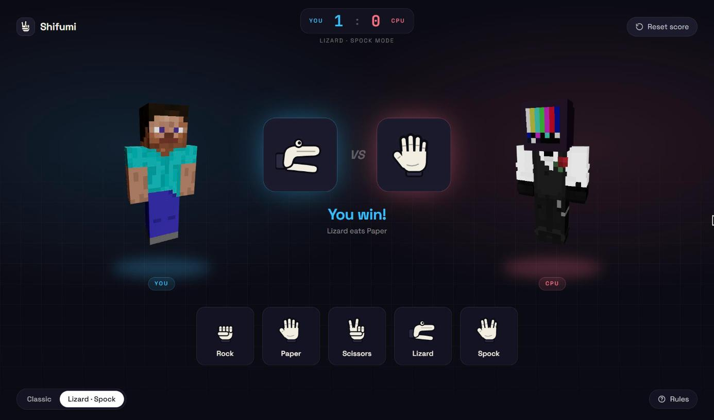
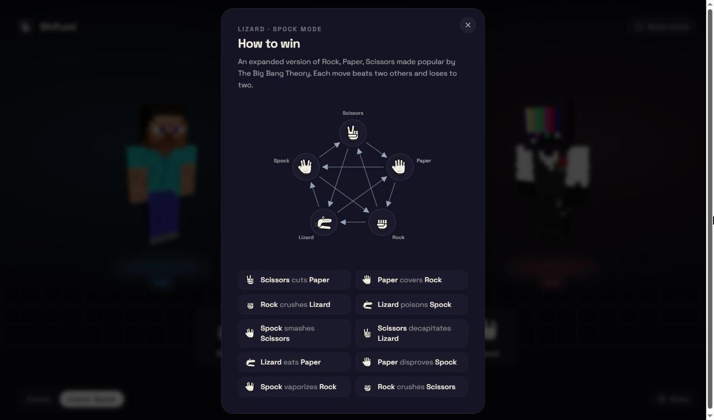

# Shifumi

**Rock, Paper, Scissors against the computer, with a Lizard · Spock mode for the brave.**

A small browser game built as an exercise for Play/Makers. Two animated 3D characters face off while you pick a hand; the round result, the rule that decided it and the running score update instantly.

**[Play it live →](https://shifumigame.vercel.app/)**



## Features

- **Two modes**: Classic (rock, paper, scissors) and Lizard · Spock (five moves, ten rules); switching resets the score
- **Instant rounds**: the CPU picks at the same time and the winning rule is spelled out ("Lizard poisons Spock")
- **3D fighters**: animated characters rendered with React Three Fiber on each side of the arena
- **Rules at a glance**: a diagram and list of every matchup for the current mode
- **Session score** with a one-click reset



## Tech stack

React 18 · TypeScript · Vite · Tailwind CSS · Framer Motion · React Three Fiber · Drei · Headless UI

The hand gestures, rules diagram and favicon are hand-built SVGs; the only bitmaps left are the 3D models' textures.

## Getting started

```bash
npm install
npm run dev
```

| Command | Description |
| --- | --- |
| `npm run dev` | Start the dev server |
| `npm run build` | Type-check and build for production |
| `npm run preview` | Preview the production build |
| `npm run lint` | Lint the project |
